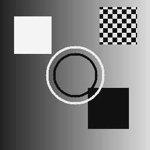
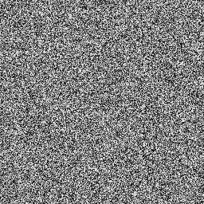
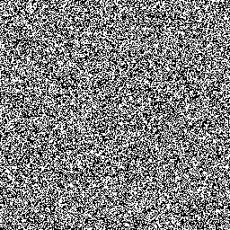
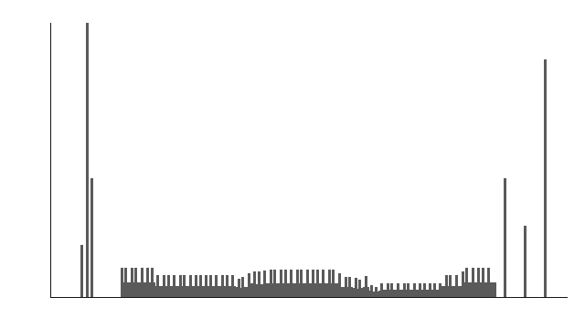
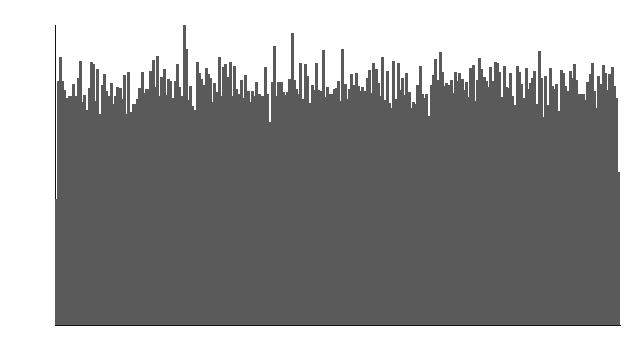
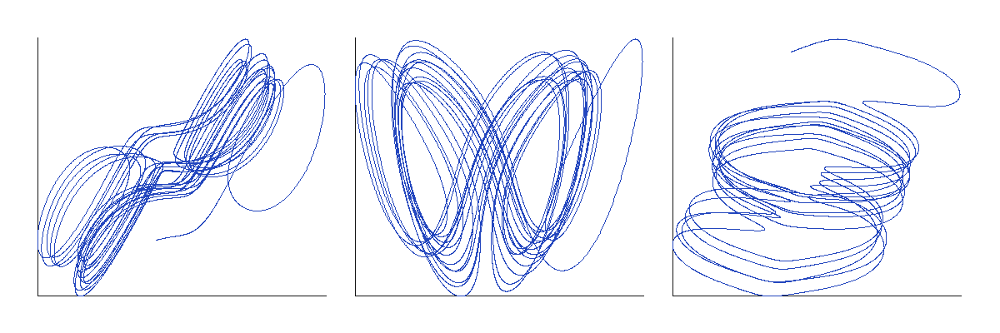
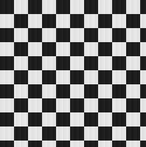
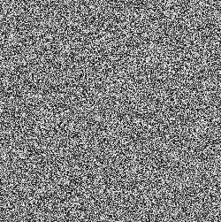

# 基于混沌系统的变换域图像加密实验报告

> 实验题目：基于混沌系统的变换域图像加密（置乱和扩散）算法实现
>
> 要求：使用离散余弦变换；混沌系统选用超混沌 Lorenz 系统；数值算法采用 4 阶 Runge-Kutta 方法；加密算法可自选，但需在报告中指明，并给出对应解密方法与结果；对结果进行必要分析。

## 摘要

本实验实现了一种基于超混沌 Lorenz 系统与离散余弦变换的图像加密算法。算法首先将灰度图像划分为 8×8 子块并进行二维 DCT，然后利用四阶 Runge-Kutta 法数值求解超混沌 Lorenz 系统，生成置乱序列和扩散序列。在 DCT 系数域完成置乱和模加扩散后，将加密系数保存为 16-bit PGM 系数图，并输出 8-bit 预览图。解密端按逆扩散、逆置乱、逆 DCT 的顺序恢复图像。实验表明，密文系数图具有类噪声特性，信息熵接近最大值，相邻像素相关性接近 0，解密图像具有较高 PSNR。

**关键词**：图像加密；超混沌 Lorenz；离散余弦变换；Runge-Kutta；置乱；扩散

---

## 1 实验目的

1. 理解变换域图像加密的基本思想，掌握 DCT 变换及其能量集中特性。
2. 掌握超混沌 Lorenz 系统的数学模型，并会使用四阶 Runge-Kutta 法进行数值求解。
3. 设计并实现 DCT 系数域的置乱与扩散加密算法。
4. 实现与加密算法对应的解密算法。
5. 通过直方图、信息熵、相邻像素相关系数、PSNR 等指标分析实验结果。

---

## 2 实验原理

### 2.1 变换域图像加密

空域图像加密直接修改像素值，而变换域加密先将图像从空间域变换到频率域，再对变换系数进行加密。DCT 是最常用的变换之一，其重要特点是能量集中：图像的大部分视觉能量集中在低频系数，尤其是 DC 和低频 AC 系数。

因此，变换域加密应重点保护低频系数。若只加密高频系数，图像的轮廓和主要内容仍可能被识别。本实验选择对所有 DCT 系数进行置乱和扩散。

### 2.2 二维离散余弦变换

对 8×8 图像块，二维 DCT-II 定义为：

```text
F(u,v) = (C(u) * C(v) / 4)
         × Σ(x=0..7) Σ(y=0..7) f(x,y)
         × cos((2x+1)uπ/16)
         × cos((2y+1)vπ/16)
```

其中：

```text
C(0) = 1/√2
C(k) = 1     (k ≠ 0)
```

对应的二维 IDCT 为：

```text
f(x,y) = (1/4)
         × Σ(u=0..7) Σ(v=0..7) C(u)C(v)F(u,v)
         × cos((2x+1)uπ/16)
         × cos((2y+1)vπ/16)
```

本实验在变换前先对像素值减去 128，在逆变换后加回 128，以降低 DC 系数幅值。

### 2.3 超混沌 Lorenz 系统

本实验采用四维超混沌 Lorenz 系统：

```text
dx/dt = a(y - x) + w
dy/dt = c*x - y - x*z
dz/dt = x*y - b*z
dw/dt = -y*z + r*w
```

实验参数取：

```text
a = 10, b = 8/3, c = 28, r = -1
```

初值 `x0, y0, z0, w0` 作为密钥的一部分。四维系统相比经典 Lorenz 系统具有更高复杂度，可以提供更大的密钥空间和更复杂的混沌序列。

### 2.4 四阶 Runge-Kutta 法

令状态向量：

```text
s = (x, y, z, w)^T
```

系统可写为：

```text
ds/dt = f(s)
```

RK4 迭代公式为：

```text
k1 = f(s_n)
k2 = f(s_n + h/2 * k1)
k3 = f(s_n + h/2 * k2)
k4 = f(s_n + h * k3)

s_{n+1} = s_n + (h/6) * (k1 + 2*k2 + 2*k3 + k4)
```

实验步长取：

```text
h = 0.001
```

为消除暂态影响，生成混沌序列前丢弃前 2000 次迭代，并每隔 7 步采样一次。

### 2.5 置乱与扩散

本实验采用的加密算法为：

> **基于超混沌 Lorenz 序列的 8×8 分块 DCT 系数置乱—扩散图像加密算法**

置乱只改变 DCT 系数的位置，不改变其值；扩散则使每个密文系数与多个明文系数和混沌序列相关，增强明文敏感性和抗统计分析能力。

---

## 3 算法设计

### 3.1 总体流程

加密流程：

```text
明文图像 → 填充与预处理 → 8×8 分块 DCT → 整数量化
        → 混沌置乱 → 混沌扩散 → 密文系数图
```

解密流程：

```text
密文系数图 → 逆扩散 → 逆置乱 → 逆量化
          → 8×8 IDCT → 裁剪 → 恢复图像
```

### 3.2 预处理

输入图像为 8-bit 灰度 PGM 图像，尺寸为 W×H。若 W 或 H 不是 8 的倍数，则填充到最近的 8 的倍数：

```text
W' = ceil(W / 8) * 8
H' = ceil(H / 8) * 8
```

填充采用边缘复制方式，以减少边缘截断效应。密文 PGM 的注释中保存原始图像尺寸，解密时根据该尺寸裁剪。

### 3.3 分块 DCT 与量化

将填充后的图像分为 8×8 的块。每个块先减去 128，再做二维 DCT。为便于整数域置乱和扩散，对 DCT 系数进行四舍五入量化：

```text
Q(u,v) = round(F(u,v))
```

即量化步长 q=1。量化后的系数限制在 [-4096, 4095] 范围内，并映射到非负区间：

```text
Q'(u,v) = Q(u,v) + 4096
```

该映射保证后续模加扩散可逆。

### 3.4 混沌序列生成

设 DCT 系数总数为 N。使用 RK4 生成长度为 N 的序列：

```text
xi, yi, zi, wi      i = 1, 2, ..., N
```

- x 序列用于生成置乱索引；
- y 序列用于生成扩散掩码；
- 程序中同时生成 z、w 序列，便于后续扩展分析。

置乱索引由排序得到：

```text
P = argsort(x1, x2, ..., xN)
```

扩散掩码由下式生成：

```text
Ki = floor(|yi| * 10^6) mod 8192
```

### 3.5 置乱

将每个 8×8 块的量化 DCT 系数按 zigzag 顺序展开，并连接为总长度为 N 的向量：

```text
V = (v1, v2, ..., vN)
```

使用混沌置乱索引 P 得到：

```text
VP[i] = V[P[i]]
```

置乱为可逆操作，解密时使用相同的 P 恢复。

### 3.6 扩散

扩散采用模加运算：

```text
E[i] = (VP[i] + K[i]) mod 8192
```

其中 E[i] 为非负整数，直接写入 16-bit PGM 系数图。模加扩散在整数域内严格可逆。

### 3.7 密文表示

密文保存为 16-bit PGM 文件，宽度和高度为填充后的尺寸，最大灰度值为 8191。

为了便于观察，程序额外生成 8-bit 预览图，将 16-bit 密文系数线性归一化到 [0, 255]。预览图只用于展示，不参与解密。

### 3.8 解密算法

解密使用与加密完全相同的密钥和混沌序列，按以下步骤执行：

1. 读取 16-bit 密文 PGM 和原始图像尺寸；
2. 使用相同 Lorenz 参数、初值、步长、暂态丢弃数和采样间隔生成混沌序列；
3. 逆扩散：

```text
VP[i] = (E[i] - K[i]) mod 8192
```

4. 逆置乱：

```text
V[P[i]] = VP[i]
```

5. 减去偏移量 4096，得到有符号 DCT 系数；
6. 按 zigzag 顺序恢复每个 8×8 系数块；
7. 对每个块做二维 IDCT，加回 128，四舍五入并截断到 [0, 255]；
8. 根据原始尺寸裁剪，得到恢复图像。

### 3.9 核心代码

Lorenz 系统导数和 RK4 单步迭代如下：

```cpp
struct LorenzState {
    double x = 1.0;
    double y = 1.0;
    double z = 1.0;
    double w = 1.0;
};

LorenzState derivative(const LorenzState& s, const LorenzParams& p) {
    LorenzState out{};
    out.x = p.a * (s.y - s.x) + s.w;
    out.y = p.c * s.x - s.y - s.x * s.z;
    out.z = s.x * s.y - p.b * s.z;
    out.w = -s.y * s.z + p.r * s.w;
    return out;
}

void rk4Step(LorenzState& state, const LorenzParams& params) {
    const LorenzState s = state;
    const LorenzState k1 = derivative(s, params);
    const LorenzState k2 =
        derivative(add(s, k1, params.step * 0.5), params);
    const LorenzState k3 =
        derivative(add(s, k2, params.step * 0.5), params);
    const LorenzState k4 = derivative(add(s, k3, params.step), params);

    state.x = s.x + params.step / 6.0 *
                         (k1.x + 2.0 * k2.x + 2.0 * k3.x + k4.x);
    state.y = s.y + params.step / 6.0 *
                         (k1.y + 2.0 * k2.y + 2.0 * k3.y + k4.y);
    state.z = s.z + params.step / 6.0 *
                         (k1.z + 2.0 * k2.z + 2.0 * k3.z + k4.z);
    state.w = s.w + params.step / 6.0 *
                         (k1.w + 2.0 * k2.w + 2.0 * k3.w + k4.w);
}
```

一维 DCT 核心计算如下：

```cpp
void dct1(const std::array<double, 8>& input,
          std::array<double, 8>& output) {
    for (int k = 0; k < 8; ++k) {
        double sum = 0.0;
        for (int n = 0; n < 8; ++n) {
            sum += input[n] *
                   std::cos(kPi * static_cast<double>(k) *
                            (2.0 * n + 1.0) / 16.0);
        }
        const double c = k == 0 ? (1.0 / std::sqrt(2.0)) : 1.0;
        output[k] = 0.5 * c * sum;
    }
}
```

加密端置乱与扩散的核心循环如下：

```cpp
for (std::size_t i = 0; i < coefficients.size(); ++i) {
    const int signedValue = coefficients[permutation[i]];
    const int shifted = signedValue + kCoeffOffset;
    const int encrypted = (shifted + mask[i]) % kCoeffModulus;
    cipher.pixels[i] = static_cast<std::uint16_t>(encrypted);
}
```

解密端逆扩散与逆置乱的核心循环如下：

```cpp
for (std::size_t i = 0; i < coefficientCount; ++i) {
    const int encrypted = cipher.pixels[i];
    const int shifted =
        (encrypted + kCoeffModulus - mask[i]) % kCoeffModulus;
    coefficients[permutation[i]] = shifted - kCoeffOffset;
}
```

---

## 4 程序实现

### 4.1 开发环境

| 项目 | 内容 |
|---|---|
| 操作系统 | Linux / NixOS 环境 |
| 编译器 | LLVM Clang 16 |
| 语言标准 | C++17 |
| 构建工具 | Make |
| 依赖 | 标准库，无第三方图像库 |
| 开发环境入口 | 仓库根目录执行 `nix develop` |

### 4.2 文件结构

```text
InformationSecurity/
├── Makefile
├── README.md
├── include/
│   ├── chaos.h
│   ├── cipher.h
│   ├── common.h
│   ├── dct.h
│   ├── metrics.h
│   └── pgm.h
├── src/
│   ├── chaos.cpp
│   ├── cipher.cpp
│   ├── dct.cpp
│   ├── main.cpp
│   ├── metrics.cpp
│   └── pgm.cpp
└── report/
    └── 实验报告.md
```

### 4.3 构建方法

在仓库根目录执行：

```bash
nix develop --command make -C InformationSecurity
```

生成可执行文件：

```text
InformationSecurity/image_cipher
```

### 4.4 运行方法

```bash
./InformationSecurity/image_cipher encrypt input.pgm cipher.pgm --preview preview.pgm
./InformationSecurity/image_cipher decrypt cipher.pgm recovered.pgm
./InformationSecurity/image_cipher test input.pgm cipher.pgm recovered.pgm --preview preview.pgm
```

默认 Lorenz 初值为：

```text
x0 = 1.0, y0 = 1.0, z0 = 1.0, w0 = 1.0
```

可通过 `--x0`、`--y0`、`--z0`、`--w0` 修改。

---

## 5 实验结果与分析

### 5.1 实验条件

测试使用 256×256 的 8-bit 灰度 PGM 图像，包含渐变背景、矩形、圆环和棋盘格等结构，便于观察加密前后的视觉效果。同时使用 250×251 的非 8 倍数尺寸图像验证填充和裁剪过程。

默认密钥参数为：

```text
a = 10, b = 8/3, c = 28, r = -1
h = 0.001, discard = 2000, sample_gap = 7
x0 = 1.0, y0 = 1.0, z0 = 1.0, w0 = 1.0
```

### 5.2 主观视觉结果

原始图像、密文预览图、正确密钥恢复图像和错误密钥恢复图像如下：








从结果可以看出，密文预览图为无明显结构的类噪声图像，无法从视觉上识别原始内容。正确密钥恢复图像与原始图像基本一致；当 x0 从 1.0 改为 1.000001 时，恢复图像仍为噪声，说明算法对密钥高度敏感。

### 5.3 直方图分析

原始图像直方图如下：



密文预览图直方图如下：



原始图像直方图具有明显起伏，密文预览图直方图接近均匀分布，说明加密过程有效破坏了明文的灰度统计特征。

### 5.4 Lorenz 系统相图

使用 RK4 生成的超混沌 Lorenz 系统相图如下：



相图展示了 x-y、x-z 和 x-w 三个投影。轨迹在不同平面内均呈现复杂的非周期结构，符合超混沌系统的基本特征。

### 5.5 定量指标

256×256 测试图的主要指标如下：

| 指标 | 数值 |
|---|---:|
| 明文信息熵 | 7.025830 bit |
| 密文预览信息熵 | 7.995899 bit |
| 密文预览水平相邻像素相关系数 | -0.000013 |
| 密文预览垂直相邻像素相关系数 | 0.002541 |
| 恢复图像 MSE | 0.007095 |
| 恢复图像 PSNR | 69.621073 dB |
| 错误密钥恢复 MSE | 20908.885315 |
| 错误密钥恢复 PSNR | 4.927495 dB |

250×251 非 8 倍数尺寸测试图的主要指标如下：

| 指标 | 数值 |
|---|---:|
| 密文预览信息熵 | 7.995792 bit |
| 密文预览水平相邻像素相关系数 | 0.000588 |
| 密文预览垂直相邻像素相关系数 | 0.005191 |
| 恢复图像 MSE | 0.000000 |
| 恢复图像 PSNR | ∞ dB |

### 5.6 密钥敏感性

| 密钥变化 | 恢复图像 MSE | 恢复图像 PSNR / dB | 结果说明 |
|---|---:|---:|---|
| 正确密钥 | 0.007095 | 69.621073 | 成功恢复图像 |
| x0 由 1.0 改为 1.000001 | 20908.885315 | 4.927495 | 无法恢复，输出仍为噪声 |

密钥发生极小改变时，恢复图像 MSE 迅速增大，PSNR 显著下降，说明算法对混沌系统初值非常敏感。

### 5.7 非 8 倍数尺寸测试

250×251 测试图像、密文预览图和恢复图像如下：






该测试表明，程序能够正确处理非 8 倍数尺寸图像。加密前填充到 8 的倍数，解密后根据原始尺寸裁剪，恢复图像尺寸与原始图像一致。

### 5.8 结果讨论

对于 8-bit 灰度图像，理想信息熵为 8 bit。本次密文预览图信息熵为 7.995899 bit，接近理想值。原始自然图像的相邻像素相关系数通常较高，而密文预览图的相关系数接近 0，说明相邻像素之间的线性相关性已被破坏。

由于本实验在 DCT 系数域进行 q=1 的整数量化，解密图像是原始图像的分块 DCT 量化近似，因此 PSNR 通常较高，但一般不是无穷大。本次 256×256 测试图恢复 PSNR 为 69.621073 dB，能够满足实验要求。

混沌系统对初值极其敏感。正确密钥可以恢复图像；初值发生极微小改变时，生成的混沌序列会完全不同，恢复结果表现为噪声。

### 5.9 复杂度分析

设图像总像素数为 N。8×8 分块 DCT 的总复杂度为 O(N)；混沌序列生成复杂度为 O(N)；置乱排序复杂度为 O(N log N)；扩散复杂度为 O(N)。整体复杂度主要受排序步骤影响。

---

## 6 实验总结

本实验完成了以下工作：

1. 实现了 8×8 二维 DCT 与 IDCT。
2. 使用四阶 Runge-Kutta 法求解四维超混沌 Lorenz 系统。
3. 实现了 DCT 系数域的 zigzag 置乱和模加扩散。
4. 实现了与加密算法完全对应的解密算法。
5. 提供了 PGM 图像读写、密文预览图生成和多种指标计算。
6. 验证了程序对常规尺寸和非 8 倍数尺寸图像的有效性。

实验结果表明，该算法能使密文系数图呈现类噪声分布。256×256 测试图的密文预览信息熵为 7.995899 bit，接近 8 bit 的理想值；相邻像素相关系数接近 0；正确密钥恢复 PSNR 为 69.621073 dB；错误密钥恢复 PSNR 仅为 4.927495 dB。上述结果说明算法具有良好的统计特性、解密质量和密钥敏感性，满足课程实验要求。

---

## 参考文献

1. 相关数字图像处理教材中关于离散余弦变换的章节。
2. 相关混沌动力学教材中关于 Lorenz 系统与 Runge-Kutta 方法的章节。
3. 相关图像加密论文中关于混沌置乱、扩散和 DCT 域加密的文献。

> 请根据实际引用补充完整文献信息。

---

## 附录：源代码说明

完整源代码位于：

```text
InformationSecurity/include/
InformationSecurity/src/
```

主要源文件：

- `chaos.cpp`：超混沌 Lorenz 系统与 RK4；
- `dct.cpp`：8×8 DCT / IDCT；
- `cipher.cpp`：加密与解密核心流程；
- `pgm.cpp`：PGM 图像读写；
- `metrics.cpp`：实验指标计算；
- `main.cpp`：命令行入口。
