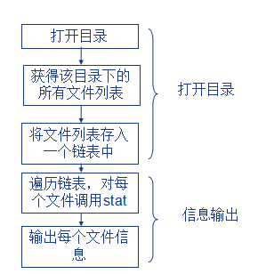
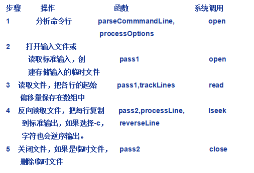

# 实验（2）文件管理系统调用

## 1. 编写 C/C++ 程序，定制自己的 ls 命令

要求提供至少三种参数，对应三种不同的输出方式：

本程序实现的参数及输出方式如下：

| 参数 | 输出方式 |
| --- | --- |
| 不带 `-l`、`-i` | 只输出文件名 |
| `-l` | 长格式输出，显示权限、链接数、所有者、大小、修改时间和文件名 |
| `-i` | 显示 inode 号和文件名 |
| `-R` | 递归列出子目录 |
| `-a` | 显示包括隐藏文件在内的所有文件 |

参数可以组合使用，例如：

```bash
./myls -a -l -R -i .
```



## 2. 对文本文件的内容逆序输出

要求按行、按词、同时按行和词逆序三种方式都要提供：

对应参数如下：

| 参数 | 输出方式 |
| --- | --- |
| `-l` | 反转整行顺序 |
| `-w` | 反转每行中的单词顺序 |
| `-lw` 或 `-wl` | 同时反转整行顺序和单词顺序 |

使用示例：

```bash
./reverse -l file.txt    # 按行逆序
./reverse -w file.txt    # 按词逆序
./reverse -lw file.txt   # 同时按行和词逆序
```



## 3. 实现一个简易文件系统审计工具 fs_auditor

编写一个程序 `fs_auditor`，对指定目录树进行扫描和统计，并生成审计报告。

### 程序调用方式

```bash
./fs_auditor 审计报告名
```

例如：

```bash
./fs_auditor /home/user/project report.txt
```

### 功能要求

程序需要递归遍历指定目录，对每个文件/目录执行以下操作：

#### （1）获取文件信息

- 使用 `stat()` 或 `lstat()` 获取文件元数据；
- 区分普通文件、目录、符号链接、硬链接等类型；
- 获取文件大小、权限、所有者 UID/GID、修改时间等信息。

#### （2）统计信息

- 普通文件数量；
- 目录数量；
- 符号链接数量；
- 硬链接数量（链接数大于 1 的普通文件）；
- 所有普通文件的总大小；
- 最大文件和最小文件的路径及大小；
- 不可读文件数量；
- 可执行文件数量。

#### （3）特殊处理

- 遇到符号链接时，使用 `lstat()` 获取链接本身信息，而不是目标文件；
- 遇到权限不足的文件或目录时，不能崩溃，应记录错误并继续；
- 避免重复统计硬链接指向的同一 inode，硬链接文件只统计一次；
- 跳过 `.` 和 `..` 目录；
- 对无法打开的目录输出警告信息到标准错误。

#### （4）生成报告

将结果写入指定报告文件，格式示例：

```text
=== File System Audit Report ===
Target directory: /home/user/project

Statistics:
  Regular files:    128
  Directories:      15
  Symbolic links:   3
  Hard links:       7
  Unreadable files: 2
  Executable files: 10
  Total size:       1048576 bytes

Largest file:  /home/user/project/data/big.bin (524288 bytes)
Smallest file: /home/user/project/README.md (0 bytes)

Errors:
  /home/user/project/secret: Permission denied
```

### 技术要求

- 必须使用 POSIX 系统调用，不能只依赖标准 C 库函数：
  - `open()`、`read()`、`close()`
  - `stat()`、`lstat()`
  - `opendir()`、`readdir()`、`closedir()`
  - `access()` 或 `faccessat()`
  - `write()` 或 `fprintf()` 写入报告文件
- 递归遍历目录时，需要自行实现目录遍历逻辑；
- 所有系统调用都必须进行错误检查；
- 程序退出码规范：
  - 成功：`0`
  - 参数错误：`1`
  - 目录无法访问：`2`
  - 报告文件无法创建：`3`

### 选做扩展

本程序已实现以下选做扩展：

#### （1）支持按文件扩展名过滤统计

使用 `-e` 参数指定扩展名，例如：

```bash
./fs_auditor -e cpp <目录路径> <报告文件名>
```

实现位置：

- 参数解析：[main/main.cpp](./main/main.cpp)
- 扩展名判断：[src/fs_auditor.cpp](./src/fs_auditor.cpp)
- 报告中的过滤条件输出：[src/report.cpp](./src/report.cpp)

#### （2）支持多线程并行遍历子目录

使用 `-j` 参数指定工作线程数，例如：

```bash
./fs_auditor -j 4 <目录路径> <报告文件名>
```

实现位置：

- 线程数参数解析与线程池创建：[main/main.cpp](./main/main.cpp)
- 线程池接口：[include/thread_pool.h](./include/thread_pool.h)
- 线程池实现：[src/thread_pool.cpp](./src/thread_pool.cpp)
- 子目录扫描任务提交：[src/fs_auditor.cpp](./src/fs_auditor.cpp)

#### （3）支持显示每个文件的权限字符串

扫描时使用 `mode_string()` 生成类似 `drwxr-xr-x` 的权限字符串，并在报告中输出 `Files (permission strings)` 部分。

实现位置：

- 权限字符串生成：[src/fs_auditor.cpp](./src/fs_auditor.cpp)
- 报告输出：[src/report.cpp](./src/report.cpp)

#### （4）支持统计最近 7 天修改过的文件数量

扫描普通文件时，根据文件的修改时间 `st_mtime` 与扫描开始时间计算文件年龄，统计 7 天内修改过的文件，并在报告中输出 `Recent files`。

实现位置：

- 时间判断与计数：[src/fs_auditor.cpp](./src/fs_auditor.cpp)
- 报告输出：[src/report.cpp](./src/report.cpp)
