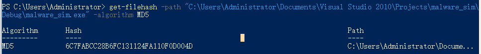
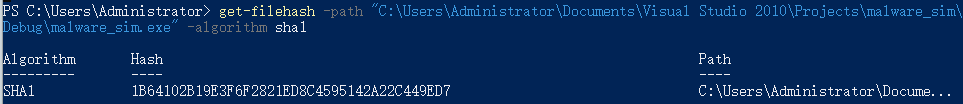
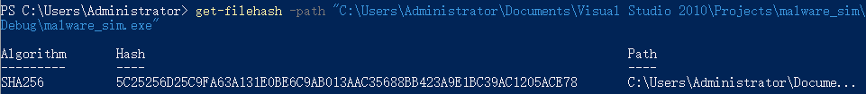
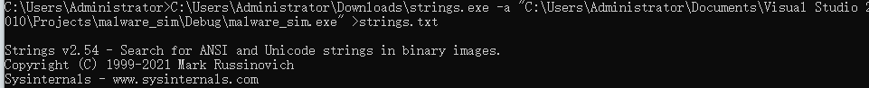
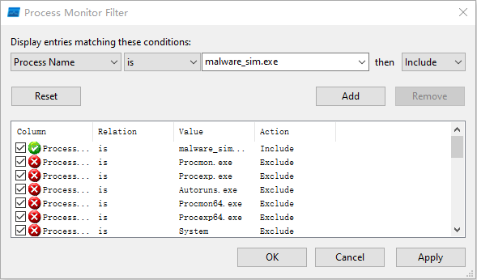
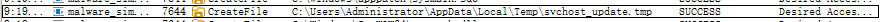
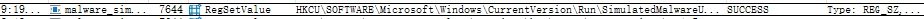

# 《软件安全实验》实验指导书

实验项目：恶意软件分析与防治

实验名称：恶意软件典型行为分析

实验环境：

- 操作系统：Windows 7/10/11
- 开发环境：Visual Studio 2013及以后版本（编译 C 程序）
- 分析工具：Process Explorer、Process Monitor、TCPView、Strings、CFF Explorer等

实验核心：通过可控的模拟恶意代码 C 程序，学习静态分析 + 动态分析全流程，掌握恶意代码典型行为识别方法。

实验要求：完成全部实验、记录现象、撰写实验报告。

安全警告：本实验必须在具有安全可控的实验机或隔离环境中进行。虽然提供的代码为模拟行为，但修改注册表和创建文件等操作仍需谨慎。

## 一、实验目的

1. 理解 Windows 平台恶意代码的典型行为（文件操作、进程操作、注册表操作、网络连接）。
2. 掌握恶意代码静态分析方法（文件属性、PE 结构、反编译特征）。
3. 掌握恶意代码动态分析方法（进程监控、文件系统监控、注册表监控、网络监控）。
4. 掌握 Process Explorer、Process Monitor、TCPview 等分析工具的使用方法。
5. 建立恶意代码防治的基础安全意识。

## 二、实验原理

**1. 恶意代码典型行为**

- 文件行为：创建、写入、删除文件；
- 进程行为：创建子进程、隐藏进程、注入进程；
- 注册表行为：修改启动项、篡改系统配置；
- 网络行为：建立连接、监听端口、数据传输。

**2. 核心分析技术**

- 静态分析：不运行程序，分析文件元数据、PE 结构、代码特征；
- 动态分析：运行程序，实时监控系统资源调用、行为轨迹。

**3. 实验工具作用**

所有推荐工具均为微软官方 Sysinternals 套件或常用开源工具。

- Process Explorer：进程详情、句柄、DLL 加载监控；下载地址：https://learn.microsoft.com/en-us/sysinternals/downloads/process-explorer
- Process Monitor：文件、注册表、进程、线程全行为监控；下载地址：https://learn.microsoft.com/en-us/sysinternals/downloads/procmon
- TCPview：网络端口、TCP/UDP 连接监控；下载地址：https://learn.microsoft.com/en-us/sysinternals/downloads/tcpview
- Strings：查看文件中的字符串 下载地址：https://learn.microsoft.com/en-us/sysinternals/downloads/strings
- CFF Explorer：PE 文件结构解析。下载地址：https://ntcore.com/files/CFF_Explorer.zip

## 三、实验准备

1. 下载安装实验工具；
2. 关闭杀毒软件（避免程序被拦截）。

## 四、实验内容

### 实验 1：模拟恶意代码

编写一个仅用于教学、无破坏性的 C 程序，模拟恶意代码 4 类典型行为：

将下方的C语言代码保存为 `malware_sim.c`。该程序模拟了以下行为：

- 文件行为：在临时目录创建一个可疑文件。
- 注册表行为：尝试在 `HKCU\Software\Microsoft\Windows\CurrentVersion\Run` 下添加启动项。
- 网络行为：尝试建立一个TCP连接（连接到本地回环地址，确保无实际危害，但会产生网络连接记录）。
- 进程行为：打印自身PID，模拟注入前的侦察；创建计算器进程。

```c
#include <stdio.h>
#include <stdlib.h>
#include <winsock2.h>
#include <ws2tcpip.h>
#include <windows.h>
// 链接Ws2_32.lib库
#pragma comment(lib, "Ws2_32.lib")

#define REG_KEY_PATH "Software\\Microsoft\\Windows\\CurrentVersion\\Run"
#define REG_VALUE_NAME "SimulatedMalwareUpdate"
#define SIMULATED_FILE_NAME "svchost_update.tmp"

#define BAIDU_HOST "www.baidu.com"
#define BAIDU_PORT "80"

// 函数声明
void simulateFileOperation();
void simulateProcessOperation();
void simulateRegistryPersistence();
void simulateNetworkConnection();

int main() {
    printf("========================================\n");
    printf("  Malware Behavior Simulator Started\n");
    printf("  PID: %d\n", GetCurrentProcessId());
    printf("========================================\n");
    printf("[*] Press Enter to start simulation steps...\n");
    getchar();

    // 1. 模拟进程操作
    printf("\n[*] Step 1: Simulating Process Operations...\n");
    simulateProcessOperation();

    // 2. 模拟文件操作
    printf("\n[*] Step 2: Simulating File Operations...\n");
    simulateFileOperation();

    // 3. 模拟注册表持久化
    printf("\n[*] Step 3: Simulating Registry Persistence...\n");
    simulateRegistryPersistence();

    // 4. 模拟网络连接
    printf("\n[*] Step 4: Simulating Network Connection...\n");
    simulateNetworkConnection();

    printf("\n[+] Simulation Completed. Check analysis tools for logs.\n");
    printf("[*] Press Enter to exit and clean up...\n");
    getchar();

    // 清理工作：删除创建的注册表项和文件（可选，实验后恢复环境）

    char tempPath[MAX_PATH];
    GetTempPathA(MAX_PATH, tempPath);
    char filePath[MAX_PATH];
    _snprintf(filePath, MAX_PATH, "%s%s", tempPath, SIMULATED_FILE_NAME);
    DeleteFileA(filePath);

    return 0;
}

void simulateProcessOperation() {
    STARTUPINFOA si = { 0 };
    PROCESS_INFORMATION pi = { 0 };
    si.cb = sizeof(STARTUPINFOA);
    printf("[*] Current Process ID: %d\n", GetCurrentProcessId());
printf("[*] Parent Process ID: %d\n", GetCurrentProcessId());
// 进程行为1：创建系统计算器 calc.exe
    CreateProcess(NULL,
        (LPSTR)"calc.exe",
        NULL, NULL,
        FALSE,
        0,
        NULL, NULL,
        &si, &pi
    );
    printf("[+] subprocess calc.exe ID: %d\n", pi.dwProcessId);

    Sleep(1000);// 留出时间让监控工具捕获进程启动

    // 2. 终止进程
    if (TerminateProcess(pi.hProcess, 1)) {
        printf("[-]Process terminated successfully.\n");
    } else {
        printf("[!]TerminateProcess failed (%d).\n", GetLastError());
    }

    // 3. 清理资源
    // 关闭进程和线程句柄，释放内核对象引用
    CloseHandle(pi.hProcess);
    CloseHandle(pi.hThread);
}

void simulateFileOperation() {
    char tempPath[MAX_PATH];
    char filePath[MAX_PATH];

    // 获取临时目录路径
    if (GetTempPathA(MAX_PATH, tempPath) == 0) {
        printf("[-] Failed to get temp path.\n");
        return;
    }

    _snprintf(filePath, MAX_PATH, "%s%s", tempPath, SIMULATED_FILE_NAME);

    // 创建文件
    HANDLE hFile = CreateFileA(
        filePath,
        GENERIC_WRITE,
        0,
        NULL,
        CREATE_ALWAYS,
        FILE_ATTRIBUTE_NORMAL,
        NULL
    );

    if (hFile != INVALID_HANDLE_VALUE) {
        const char* data = "This is a simulated malicious payload content.";
        DWORD bytesWritten;
        WriteFile(hFile, data, strlen(data), &bytesWritten, NULL);
        CloseHandle(hFile);
        printf("[+] File created at: %s\n", filePath);
    }
    else {
        printf("[-] Failed to create file.\n");
    }
    Sleep(1000);
}

void simulateRegistryPersistence() {
    HKEY hKey;
    LONG result;
    char exePath[MAX_PATH];

    // 获取当前可执行文件路径
    GetModuleFileNameA(NULL, exePath, MAX_PATH);

    // 打开注册表键
    result = RegOpenKeyExA(
        HKEY_CURRENT_USER,
        REG_KEY_PATH,
        0,
        KEY_SET_VALUE,
        &hKey
    );

    if (result == ERROR_SUCCESS) {
        // 设置注册表值
        result = RegSetValueExA(
            hKey,
            REG_VALUE_NAME,
            0,
            REG_SZ,
            (const BYTE*)exePath,
            strlen(exePath) + 1
        );

        if (result == ERROR_SUCCESS) {
            printf("[+] Registry key added for persistence: %s\n", REG_VALUE_NAME);
        }
        else {
            printf("[-] Failed to set registry value. Error: %ld\n", result);
        }
        RegCloseKey(hKey);
    }
    else {
        printf("[-] Failed to open registry key. Error: %ld\n", result);
    }
    Sleep(1000);
}

void simulateNetworkConnection() {
    WSADATA wsaData;
    SOCKET sock = INVALID_SOCKET;
    struct addrinfo hints, *res, *p;
    int iResult;
    int count;

    // 1. 初始化 Winsock
    iResult = WSAStartup(MAKEWORD(2, 2), &wsaData);
    if (iResult != 0) {
        printf("WSAStartup failed: %d\n", iResult);
        return;
    }

    // 2. 设置地址信息提示
    ZeroMemory(&hints, sizeof(hints));
    hints.ai_family = AF_UNSPEC;     // 允许 IPv4 或 IPv6
    hints.ai_socktype = SOCK_STREAM; // TCP
    hints.ai_protocol = IPPROTO_TCP;

    // 3. 解析百度域名
    printf("Resolving %s...\n", BAIDU_HOST);
    iResult = getaddrinfo(BAIDU_HOST, BAIDU_PORT, &hints, &res);
    if (iResult != 0) {
        printf("getaddrinfo failed: %d\n", iResult);
        WSACleanup();
        return;
    }

    // 4. 尝试5次连接
    for (count=0, p = res; p != NULL; p = p->ai_next, count++) {
        if (count == 5)
            break;

        sock = socket(p->ai_family, p->ai_socktype, p->ai_protocol);
        if (sock == INVALID_SOCKET) {
            continue;
        }

        printf("Connecting to server...\n");
        iResult = connect(sock, p->ai_addr, (int)p->ai_addrlen);
        if (iResult == SOCKET_ERROR) {
            closesocket(sock);
            sock = INVALID_SOCKET;
            continue;
        }
        break; // 连接成功
    }

    freeaddrinfo(res);

    if (sock == INVALID_SOCKET) {
        printf("Unable to connect to server!\n");
        WSACleanup();
        return;
    }

    printf("Connected to %s\n", BAIDU_HOST);

    // 保持socket打开一会儿以便工具捕获
    Sleep(2000);
    getchar();
    closesocket(sock);
    WSACleanup();
}
```

**编译步骤**

1. 打开 Visual Studio，新建“空项目”，项目名称为malware_sim，添加.c源文件，粘贴代码；
2. 生成解决方案（选择x86，Release），得到malware_sim.exe可执行文件。

提示：如果无法生成exe可执行文件，请关闭反病毒软件后再次编译。

### 实验 2：静态分析

#### 任务 1：文件基础信息与哈希提取（工具：Windows PowerShell）

1. 右键点击exe文件 -> 属性
   - 常规：大小、修改时间、文件类型；
   - 详细信息：观察是否有数字签名（通常恶意代码无签名或伪造签名）
2. 计算哈希值（MD5/SHA1/SHA256），作为恶意样本特征指纹：可在 **Windows PowerShell** 中使用 `Get-FileHash` 计算文件的哈希值，如：

   ```powershell
   MD5：Get-FileHash -Path "C:\malware_sim.exe" -Algorithm MD5
   SHA1：Get-FileHash -Path "C:\malware_sim.exe" -Algorithm SHA1
   SHA256：Get-FileHash -Path "C:\malware_sim.exe"
   ```

如：





#### 任务 2：PE 结构分析（工具：CFF Explorer）

1. 打开工具CFF Explorer，加载 `malware_sim.exe`。
2. Import Directory ：查找关键的DLL和函数。
   - KERNEL32.dll 中：`CreateFileA`, `WriteFile`, `CreateProcessA`, `TerminateProcess`, `RegOpenKeyExA`, `RegSetValueExA`等
   - WS2_32.dll 中： `socket`, `connect`, `WSAStartup`等

思考：这些导入函数暗示了程序可能具备什么功能？

#### 任务 3：字符串静态提取（使用 Strings 工具）

1. 打开命令行，运行 `strings.exe -a malware_sim.exe > strings.txt`。
2. 打开 `strings.txt`，搜索关键词：
   - Run (注册表路径)
   - 域名或IP地址，端口号
   - ...



记录：截图保存发现的敏感字符串。

思考：这些敏感字符串暗示了程序可能具备什么功能？

### 实验3：动态分析

启动分析工具，然后运行 `malware_sim.exe`，观察实时行为。

#### 任务 1：进程监控 (Process Explorer - procexp)

1. 以管理员身份运行 procexp.exe。
2. 运行 `malware_sim.exe`。
3. 在 Process Explorer 中找到 `malware_sim.exe` 进程。

观察：

- 双击进程，查看 "Image" 标签页，确认路径、父进程。
- 查看 "TCP/IP" 标签页，观察是否有建立的连接或监听端口。
- 查看 "Strings" 标签页，对比静态分析的结果。
- 查看 "Security" 标签页，观察进程的权限令牌。

#### 任务 2：行为监控 (Process Monitor - ProcMon)

1. 以管理员身份运行 ProcMon。
2. 点击菜单工具栏的图标（Capture）关闭捕获（如果自动开始），图标（Clear）清除日志。
3. 设置过滤器 (Filter)：
   - 添加（Add）：Process Name is `malware_sim.exe` then Include
   - (可选) 排除大量噪音：Operation is not `RegQueryValue` Exclude (根据兴趣调整)

   

4. 点击菜单工具栏的（Capture）或快捷键Ctrl+E开始捕获（如果未自动开始）。
5. 运行 `malware_sim.exe` 并按回车执行各步骤。
6. 点击菜单工具栏的图标（Capture）关闭捕获，保存日志为 `.PML` 文件。
7. 分析Process Monitor的日志。

分析重点：

-  File System：查找 `CreateFile`等文件操作。记录文件路径是否为 `%TEMP%\svchost_update.tmp`。
  
-  Process and Thread：查找`CreateProcess`等进程操作，确认计算器calc.exe是否成功创建。
-  Registry：查找 `RegSetValue` 操作。确认是否写入了 `HKCU\...\Run` 键值。
  
-  Network：ProcMon对网络支持有限，主要看文件、进线程和注册表。

操作：停止捕获，保存日志为 `.PML` 文件，并截图关键事件。

#### 任务 3：网络监控 (TCPView)

1. 以管理员身份运行 TCPView。
2. 运行 `malware_sim.exe`。

观察：

- 在列表中寻找 `malware_sim.exe`。
- 观察其状态：`SYN_SENT` (尝试连接) 或 `ESTABLISHED`
- 记录远程地址和端口。
- 注意协议类型 (TCP)。


操作：截图显示该进程的网络连接状态。

## 五、实验总结与报告

请回答以下问题并整理截图：

**1. 静态分析结论：**

- 该程序导入了哪些关键API？分别对应什么功能？
- 在字符串中发现了哪些可疑信息？

**2. 动态分析结论：**

- ProcMon 捕获到了哪些具体的文件创建、进程创建和注册表修改操作？请列出完整路径。
- TCPView 显示程序尝试连接哪个IP和端口？状态是什么？
- Process Explorer 中该进程的父进程是谁？

**3. 防治策略探讨：**

- 如果这是一款真正的木马，基于上述行为，主机防护软件（如HIPS）应该在哪个环节拦截？
- 如何手动清除该模拟木马留下的痕迹（注册表项和文件）？

## 六、注意事项

1. 必须在机房带保护的实验机上运行。
2. 实验期间可临时关闭反病毒软件，避免拦截行为。
3. 权限问题：Process Monitor 和 TCPView 必须使用管理员权限运行，否则无法捕获内核级事件或所有进程的网络连接。
4. 防火墙干扰：实验机的防火墙可能会阻止 `malware_sim.exe` 的网络连接尝试，导致 TCPView 中看不到 `SYN_SENT` 状态。建议暂时关闭防火墙或添加入站/出站规则允许该程序。
5. 清理环境：实验结束后，务必检查注册表 `HKEY_CURRENT_USER\Software\Microsoft\Windows\CurrentVersion\Run` 和临时文件夹，确保没有残留文件。提供的代码已包含自动清理逻辑，但若程序中途崩溃，需手动清理。
6. 合法性声明：本实验仅用于网络安全教学与研究，程序仅教学使用，严禁外发、滥用。任何利用所学技术进行非法入侵、破坏的行为均违反法律法规。
